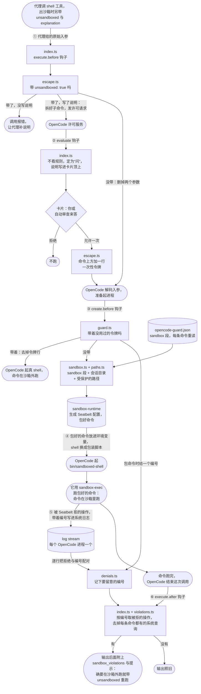

# 沙箱模块

一句话：OpenCode 2 没有系统沙箱，这个模块把 OpenCode 的每条 shell 命令套进 Claude Code 的沙箱库（`@anthropic-ai/sandbox-runtime`）里跑。沙箱挡下的命令，代理可以带上 `unsandboxed: true` 和一句说明再跑一次，模块先发许可请求，允许了才在沙箱外跑。代码在 `src/sandbox/`。这个模块不 import 自动审查模块（`docs/autoreview.md`），也不管谁来回答它发的请求。

## 架构与逻辑

### 根本需求

- 哪里都能读。
- 会话目录与写入名单里随便改，不问你；名单只放命令顺带会写的工具与缓存目录。
- 名单以外的写入要经你许可；网络全部放行。
- 放行按类别给（目录、系统能力），不按单条命令打补丁：OpenCode 的许可规则只按命令文本匹配，写法一变就失效，所以要真沙箱。

### 组成

一句话：OpenCode 跑一次 shell 调用，会先后叫插件三次：起进程前的 `execute.before` 决定要不要出沙箱，起进程时的 `create.before` 决定这条命令怎么跑，调用结束时的 `execute.after` 把沙箱这次拦下的东西附在输出后面。图里圆角框是 OpenCode 自己做的事，方框是插件里的文件，圆柱是插件读的配置和用的库，箭头上的序号是先后。

### 关键设计

| 做法 | 为什么 |
|---|---|
| 换掉跑命令的 shell（换成随插件带的包装脚本 `bin/sandboxed-shell`），不改命令文本 | OpenCode 起命令固定是 `[shell, "-c", command]`，只能改这两样；它自己的许可判定、后台任务的标题、跑完后通知代理的消息都用改过的命令，改命令文本就会到处露出一大段 `sandbox-exec -p '…'`。包好的命令经环境变量交给包装脚本；系统里没有现成能接 `-c` 又能这样跑的程序 |
| 可写的只有会话目录，不取 OpenCode 的“项目目录” | 项目目录是所在 git 仓库的根，会话开在家目录仓库里时就是整个家目录 |
| Claude 在设置之外加的保护照加，另把会话目录里的 `.opencode/`、`opencode.json(c)` 设为只读 | 项目插件下次开会话就会跑，能换掉沙箱 |
| 不写 `allowedDomains` 就不限网络、不起代理（作者定：网络全放） | 写了就走库的代理，SSH、裸 TCP 连不上 |
| 沙箱套不上（配置读不了、库报错）就拒绝执行 | 不悄悄放行 |
| 出沙箱用 shell 自己的参数，不另设工具（作者定） | 跟 Claude 的 `dangerouslyDisableSandbox`、Codex 的 `require_escalated` 一样；参数说明里写清沙箱的范围，因为 OpenCode 每次请求都重设 shell 的工具说明 |
| 在 `execute.before` 里自己发许可请求，不靠 shell 自己的判定 | shell 拆不出子命令时根本不判定，那样的命令会不问就出沙箱 |
| 请求以动作 `shell` 发，资源照 OpenCode 自己的 shell 工具拆（作者定）：调 `@opencode/core` 的 `ShellParse.scan`，版本钉成本机 OpenCode 的；按 OpenCode 的渠道选 tree-sitter 或纯 TS 扫描器；拆不出或解析失败时整条命令算一条 | 卡片与审查看到的子命令跟 OpenCode 自己问时一样；插件调不到 OpenCode 进程里的那份，只能装同版本的包；OpenCode 拆出零条时不问，出沙箱却一律要问 |
| 一律问，不带 `save`（作者定） | 规则与“完全访问”都跳不过；卡片上没有“始终允许” |
| OpenCode 自己对 shell 调用的判定，判为“问”时由模块改成放行（`autoAllowBashIfSandboxed`，没写算开；`deny` 不动） | 命令要么在沙箱里跑，要么带着出沙箱请求已经批过的令牌，再问一次没有意义。不靠 `opencode.json` 的 `*: allow`：客户端会往会话上写规则（MonoCode 每档都写 `*: ask`），OpenCode 取最后匹配的规则、会话规则排在配置之后，配置里的放行就被盖掉，每条命令都要等审查。放行在 `evaluate` 钩子里做，自动审查排在后面，看不到这些请求 |
| 令牌就是通行证：随机、只能用一次，不认命令原文，也不认目录 | `create.before` 拿不到是哪次调用，只能靠命令自己带记号；后面的插件会改写命令（rtk 把 `ls` 改成 `rtk ls`）；令牌只出现在这次调用的入参里，代理与会话记录都看不到，再比别的挡不住什么 |
| 发过的令牌记在进程级（`globalThis`），不记在插件实例里 | OpenCode 热重载插件时调用可能正在途中：旧实例在 `execute.before` 发的令牌，由新实例的 `create.before` 来收，记在实例里就对不上，命令带着令牌行落回沙箱 |
| 直接拒绝时原样抛出 OpenCode 的错误 | OpenCode 靠这个错误对象结束代理的这一步，跟它自己的卡片一样 |
| 被拦后在输出后附上 `<sandbox_violations>`，只附系统日志里真记下的拒绝，再加一句怎样出沙箱（照 Claude） | 代理只看报错猜不出是不是沙箱挡的；按报错文字猜会误判。参数说明另写清哪些算沙箱挡的、该直接带 `unsandboxed` 重跑，跟任务无关的东西被挡就告诉用户、别重跑 |
| 插件自己起 `log stream` 读拒绝，不用 sandbox-runtime 自带的记录 | 库每块输出只取第一条拒绝；机器忙时几条挤在一块，每个 shell 起来都会撞上的 `sysctl-read` 挤掉真正有用的那条（0.0.81 仍如此）。自己逐行读就不漏，也不靠库第一次 `initialize`，热重载即生效 |
| 只认插件自己发的编号；`log stream` 外面套一层 shell 等管道 | 别的进程（Claude Code 等）也会写同样格式的日志，只存自己的才不占内存；OpenCode 被强行结束时 `log stream` 不会自己退，管道一断外层就把它停掉 |
| 输出里有 `Operation not permitted`、`Permission denied` 且失败的命令，最多等 2 秒日志；别的不等 | 日志一般在命令退出后 25 毫秒内到，忙时会晚；普通失败（如 grep 没找到）不该变慢 |

### 对外的接口

- **发出的请求**：一个普通的许可请求。动作 `shell`，资源是子命令，`metadata.input` 是这次调用的入参（`command`、代理给了的 `workdir`、`unsandboxed: true`），`message` 是代理的说明，不带 `save`。谁回答都行：没有别的模块时是 OpenCode 的卡片。
- **返回给入口的**：`setupSandbox` 返回 `unreadable()`，沙箱不让读的路径（`denyRead`，含模块为 Claude 凭据加的），读不了配置时抛错。

### 配置与文件

- 装成目录插件 `~/.config/opencode/plugins/opencode-guard/`：`index.ts` 转发到 `src/index.ts`（服务端），`tui.tsx` 转发到 `src/tui.tsx`（终端界面）。终端界面的 `solid-js`、`@opentui/*`、`@opencode/theme` 由 OpenCode 运行时提供，仓库里装同版本只为类型检查。
- `~/.config/opencode/opencode-guard.json` 的 `sandbox` 段：写法同 Claude 设置里的 `sandbox`，内容照抄；每条命令前重读，改了即生效。模块不读 Claude 的设置。这个文件不在沙箱的可写范围里。Claude 专有的键里，模块只认 `autoAllowBashIfSandboxed`（写 `false` 时 shell 调用问不问交回 OpenCode 的规则）；`enabled` 不认，沙箱总是开着。
- 测试在 `test/sandbox/`；端到端要在沙箱外起 `opencode serve`（Seatbelt 不能嵌套）。
- `@opencode/plugin` 与 `@opencode/core` 钉在本机 OpenCode 的版本（2.1.2），升级 OpenCode 时一起改；`@opencode/core` 连依赖约 350 MB，第一次出沙箱时才载入（约 60 MB 内存）；sandbox-runtime 钉在 `0.0.78`。
- 被拦记录来自系统日志：每个 OpenCode 进程有一个 `/bin/sh` 套着的 `log stream` 子进程，随 OpenCode 退出。

### 终端界面

- OpenCode TUI 的 shell 许可卡片只画代理原始调用里的 `command`，不画请求的 `message`。`src/tui.tsx` 是 TUI 插件：对本模块发的出沙箱请求（动作 `shell`、`metadata.input.unsandboxed` 为真、带 `message`），在 `session.composer.top` 位置画一块，用卡片同样的底色与左边框，一行“⚠ ”加说明，看着像卡片的第一行；请求答完就消失（作者定：融进卡片）。OpenChamber 自己画 `message`，不受影响。

### 风险

- 出沙箱依赖 OpenCode shell 工具的几处细节：参数格式（Effect 的 `mapFields`）、“先 `execute.before` 后解码”、“先 `create.before` 后解析目录”。它们变了，出沙箱会失效，但命令照样在沙箱里跑，不会越权。
- 改文件工具不在沙箱里：它写会话目录里的 `.git/hooks`、`.opencode/` 不会被拦；它问不问只看 `opencode.json`。MCP 工具与插件进程也不在沙箱里。
- sandbox-runtime 是研究预览，OpenCode 2 的插件接口也还会变，升级任一边都要重跑测试。
- 拆命令跟 OpenCode 有两处对不上：插件拿不到 OpenCode 的实验配置 `experimental.portable_shell_scanner`，只按渠道选解析器；shell 工具实际用哪个 shell 要到解码后才知道，插件拿 `$SHELL` 代替（只影响 PowerShell 与否）。
- 被拦记录依赖 sandbox-runtime 给命令打的日志标记（`CMD64_<编号的 base64>_END_…_SBX`，跟在拒绝那一行后面）。格式变了只是不再附记录，命令照常跑。`ps` 这类 setuid 程序被拒不进 Seatbelt 日志，只能靠参数说明里写的迹象认。

### 还没定的事

- **还能怎样少问**：只读却在沙箱里跑不了的 `log show`、`ps`，可以按一份严格的只读命令名单直接放到沙箱外跑；Chrome 与 Playwright 的浏览器在沙箱里起不来（库的配置不许登记 Mach 服务），可以改用 OpenChamber 的浏览器面板，或往库生成的配置里补 `mach-register`。
- **沙箱里的命令能调 OpenCode 的 API**：环境里有 `OPENCODE_PASSWORD`，能建一个规则全放行的会话，让它去跑出沙箱的命令（建会话实测能成，后一步是推出来的）。要不要堵、怎么堵，还没定。
